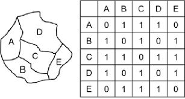

```{r}
#| label: data-setup
#| code-fold: true

library(dplyr)
library(readr)
library(stringr)
library(sf)
library(spdep)

base_path <- here::here("data")

msoa_boundaries <- st_read(
  file.path(base_path, "boundaries-msoa.geojson"),
  quiet = TRUE
) |>
  select(area_id = MSOA21CD) |>
  filter(str_starts(area_id, "W"))

area_index <- read_csv(
  file.path(base_path, "clean", "domain_msoayear.csv"),
  show_col_types = FALSE
) |>
  distinct(area_id, area_inla_id)
```


## Auxiliary data constraints and method selection

Auxiliary data are central to model-based small-area estimation, enabling different modelling approaches. The table below summarises the suitable SAE method for different scenarios of auxiliary data availability.

| Auxiliary data | [Direct estimation](direct-estimation.qmd) | [Area-level SAE](area-sae-fh.qmd) | [Unit-level SAE w/ Summaries](unit-sae-summ.qmd) | [Unit-level SAE w/ Poststrat](unit-sae-mrp.qmd) |
|---|:---:|:---:|:---:|:---:|
| Modelling: Area-level predictors |-| Yes |Optional as contextual | Optional as contextual |
| Modelling: Unit-level predictors |-|-| Yes | Yes |
| Aggregation: predictor summaries |-|-| Yes |-|
| Aggregation: poststratification table |-|-|-| Yes |
| Spatial graph |-| Yes | Yes | Yes |

This tutorial assumes that all required forms of auxiliary data are available so that each method can be demonstrated. All auxiliary data is derived from [ONS Census 2021](https://www.ons.gov.uk/census) at MSOA level.

### Spatial Adjacency Matrix

To represent spatial structure in the model, we may want to provide the model with an adjacency matrix identifying neighbouring MSOAs. Neighbours are defined using Queen contiguity: two MSOAs are adjacent if their boundaries share an edge or a point. This structure allows the model to identify potential spatial autocorrelation and borrow information across neighbouring areas, supporting predictions for areas with limited or missing survey observations.

```{r}
#| label: data-inla-graph

msoa_boundaries_sorted <- msoa_boundaries |>
  inner_join(area_index, by = "area_id") |>
  arrange(area_inla_id)

msoa_neighbours <- poly2nb(
  msoa_boundaries_sorted,
  queen = TRUE,
  row.names = msoa_boundaries_sorted$area_id
)

# Write the Queen-contiguity graph in INLA's .adj format.
spatial_graph_file <- file.path(base_path, "clean", "msoa_queen.adj")
nb2INLA(
  file = spatial_graph_file,
  nb = msoa_neighbours
)
```


### Modelling input: Area-level Predictors

Area-level SAE models need area-level predictors that plausibly explain between-area differences in the target outcome. These variables below are chosen because frequent cycling is likely to vary with population composition, density, and car access. The area-predictor input *has one row per MSOA*:

| Column | Meaning |
|---|---|
| `area_id` | MSOA estimation area |
| `pop_density` | Population density |
| `age_adult_mean` | Mean adult age |
| `female_adult_share` | Adult female share |
| `caraccess_adult_share` | Adult share with car access |

```{r}
#| label: data-area-predictors

read_csv(
  file.path(base_path, "clean", "areapred_freqcyc.csv"),
  show_col_types = FALSE
) |>
  head()
```

### Modelling input: Unit-Level Predictors

Unit-level SAE models need predictors that can be used to model the outcome at the individual level. To model individual `freq_cyclist`, we extract or transform these unit-level predictors from the survey microdata *for each individual respondent row*:

| Column | Meaning |
|---|---|
| `age` | Respondent age |
| `sex` | Respondent sex (`1` for Male, `2` for Female) |
| `caraccess` | Binary car access predictor (`1` for car/van available, `0` for none available) |

```{r}
#| label: data-unit-predictors

read_csv(
  file.path(base_path, "clean", "surveyind_freqcyc.csv"),
  show_col_types = FALSE
) |>
  select(unit_id, time_id, area_id, sex, age, caraccess) |>
  head()
```

### Aggregation input for unit-level SAE
#### Predictor area summaries 

A unit-level SAE method can aggregate unit-level model predictions to target small areas using area summaries of the corresponding predictors within the model.

E.g., 

|Predictor| Corresponding area summary |
|---|---|
|`age`, continuous|`age_adult_mean`|
|`sex_female`, binary|`female_adult_share`|
|`caraccess`, binary|`caraccess_adult_share`|

:::{.callout-note}
The same auxiliary variables can serve as area-level predictors or as area summaries used to aggregate unit-level predictions. However, their requirements differ.

- **Area-level predictors** only need to capture relevant variation between areas.
- **Area summaries for aggregation** must represent every unit-level predictor in the model and accurately describe the target population, such as adults. They therefore require more careful preparation.
:::

### Poststratification Table 

Another approach is using population cell counts, provided in a poststratification table, to aggregate fitted model predictions for each area-time cell. This weights predictions according to the target population distribution of the unit-level predictors instead of relying on area summaries. Predictors included in the poststratification table must be represented as categorical variables.

For our exercise, we use a poststratification table based on adult population account by `age_band`, `sex`, and `caraccess`, sourced from [ONS UK Census 2021](https://www.ons.gov.uk/census). The poststratification table should have *one row per area-time-age-sex-caraccess combination*:

| Column | Meaning |
|---|---|
| `area_id` | MSOA estimation area |
| `time_id` | Survey year |
| `age_band` | Census age band |
| `sex` | Male / Female |
| `caraccess` | Binary car-access indicator |
| `pop_count` | Adult population count |

```{r}
#| label: data-poststrat-head

read_csv(
  file.path(base_path, "clean", "poststrat_freqcyc_age_sex_car_21.csv"),
  show_col_types = FALSE
) |>
  head()
```
