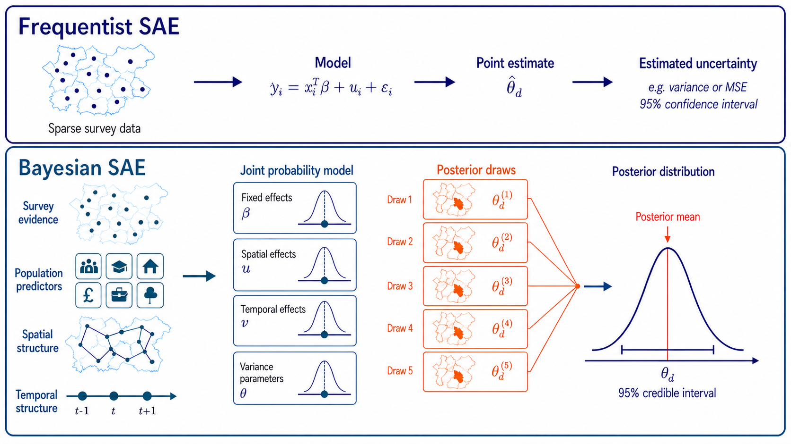
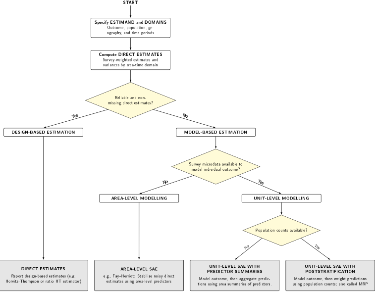

{width="100%"}

## Small-area Estimation in Urban Analytics
### What is small-area estimation?

Urban researchers rely on surveys to understand different aspects of the target populations and how they change over time, often examining survey results at different spatial scales--such as neighbourhoods, census blocks, or transport zones--to compare places, track local trends, and identify inequalities. A key challenge is that simply grouping survey responses by area can leave too few respondents to produce reliable estimates, while combining responses from several survey years can obscure changes over time and introduce bias if differences between years are not properly accounted for. Another challenge is deciding which SAE modelling and prediction method suitable for their data constraints and research questions.

This guide introduces several **Bayesian spatiotemporal small area estimation (SAE)** methods for urban analytics--with implementation in `R-INLA`--to help researchers choose a method *suited to their data limitations* using an illustrative case study of frequent cycling behaviour in Wales.

### Bayesian inference and `R-INLA`

While frequentist methods typically use a prediction formula and an estimated mean squared error (MSE) to quantify uncertainty, Bayesian approaches treat model parameters as probability distributions. Each posterior draw gives one possible set of parameter values, and recalculating the domain estimate for every draw produces a posterior distribution of plausible estimates. Its mean is the reported estimate, while its spread and quantiles describe uncertainty. 

This carries uncertainty from all model components into the estimates and supports complex spatiotemporal models.

{width="100%"}

The workbooks use `R-INLA`, the R interface to [*Integrated Nested Laplace Approximation (INLA)*](https://www.r-inla.org/). This method provides deterministic approximate Bayesian inference for latent Gaussian models and is faster than Markov chain Monte Carlo (MCMC) methods for complex spatiotemporal small area estimation models.

## Navigating the guide

This guide supports method selection based on the reliability of the direct estimates and the availability of auxiliary data. Use the decision tree below to identify an appropriate approach

{width="100%"}

1. **[Direct estimation](direct-estimation.qmd)**
2. **[Area-level SAE](area-sae-fh.qmd)**
3. **[Unit-level SAE with predictor summaries](unit-sae-summ.qmd)**
4. **[Unit-level SAE with poststratification](unit-sae-mrp.qmd)**

Finally, the **[comparative diagnostics](diagnostics.qmd)** analyse the different outputs side by side, showing the advantages and trade-offs of each approach.

## Data

The estimand is frequent cycling behaviour among adults in Welsh Middle Layer Super Output Areas (MSOAs), using three waves of the [**National Survey for Wales**](https://www.gov.wales/national-survey-wales). Reliable MSOA-level estimates can help policymakers identify inequalities in cycling participation and target active-travel interventions and infrastructure. Auxiliary data derived from the *England and Wales Census of 2021*, produced by the Office for National Statistics (ONS). 

The preparation of the **[survey data](dataprep-survey.qmd)** and **[auxiliary data](dataprep-aux.qmd)** is detailed in the following sections. The **[data preptoolkit](toolkit.qmd)** guides researchers in reformatting your own data so you can apply the codes in this guide more easily.

## About the project 

The tutorial is part of the **TRACK-UK** project by the [**City Modelling Lab**](https://citymodellinglab.uk). TRACK-UK develops spatial and statistical methods for analysing mobility patterns at fine geographic scales and assessing their implications for transport decarbonisation in the UK. The project works with academic, policy, and industry partners to produce evidence for transport and energy policy.

For questions about the guide, contact:

- **Thehuan Hoang** - University College London
- **Anna Freni-Sterrantino** - The Alan Turing Institute
- **Esra Suel** - University College London; University of Zurich

## References

**Small Area Estimation**

- Horvitz, D. G., and Thompson, D. J. (1952). "A Generalization of Sampling Without Replacement from a Finite Universe." *Journal of the American Statistical Association*, 47(260), 663-685. doi:10.1080/01621459.1952.10483446.
- Fay, R. E., and Herriot, R. A. (1979). "Estimates of Income for Small Places: An Application of James-Stein Procedures to Census Data." *Journal of the American Statistical Association*, 74(366), 269-277. doi:10.1080/01621459.1979.10482505.
- Battese, G. E., Harter, R. M., and Fuller, W. A. (1988). "An Error-Components Model for Prediction of County Crop Areas Using Survey and Satellite Data." *Journal of the American Statistical Association*, 83(401), 28-36. doi:10.1080/01621459.1988.10478561.
- Rao, J. N. K., and Yu, M. (1994). "Small-Area Estimation by Combining Time-Series and Cross-Sectional Data." *Canadian Journal of Statistics*, 22(4), 511-528. doi:10.2307/3315407.

**Multilevel Regression with Poststratification**

- Gelman, A., and Little, T. C. (1997). "Poststratification into Many Categories Using Hierarchical Logistic Regression." *Survey Methodology*, 23(2), 127-135.
- Park, D. K., Gelman, A., and Bafumi, J. (2004). "Bayesian Multilevel Estimation with Poststratification: State-Level Estimates from National Polls." *Political Analysis*, 12(4), 375-385. doi:10.1093/pan/mph024.

**Bayesian Spatial and Spatio-Temporal Modelling**

- Besag, J., York, J., and Mollié, A. (1991). "Bayesian Image Restoration, with Two Applications in Spatial Statistics." *Annals of the Institute of Statistical Mathematics*, 43(1), 1-20. doi:10.1007/BF00116466.
- Riebler, A., Sørbye, S. H., Simpson, D., and Rue, H. (2016). "An Intuitive Bayesian Spatial Model for Disease Mapping That Accounts for Scaling." *Statistical Methods in Medical Research*, 25(4), 1145-1165. doi:10.1177/0962280216660421.

**Bayesian Modelling with R-INLA**

- Blangiardo, M., and Cameletti, M. (2015). *Spatial and Spatio-Temporal Bayesian Models with R-INLA*. John Wiley & Sons. doi:10.1002/9781118950203.
- Gómez-Rubio, V. (2020). *Bayesian Inference with INLA*. CRC Press. doi:10.1201/9781315175584.
- Rue, H., Martino, S., and Chopin, N. (2009). "Approximate Bayesian Inference for Latent Gaussian Models by Using Integrated Nested Laplace Approximations." *Journal of the Royal Statistical Society: Series B*, 71(2), 319-392. doi:10.1111/j.1467-9868.2008.00700.x.
